# Diagram types

What are you showing? Pick the row that matches, copy its smallest example, and grow it. Every example here renders in pele.

| Showing                                        | Type                |
| ---------------------------------------------- | ------------------- |
| A process, decision, or flow                   | `flowchart`         |
| Actors exchanging messages in order            | `sequenceDiagram`   |
| Types, classes, or modules and their relations | `classDiagram`      |
| States and the transitions between them        | `stateDiagram-v2`   |
| Tables or entities and their relations         | `erDiagram`         |
| Work over calendar time                        | `gantt`             |
| Events in order on one line                    | `timeline`          |
| Branches and merges                            | `gitGraph`          |
| Parts of a whole (a few)                       | `pie`               |
| Ideas branching from a center                  | `mindmap`           |
| Steps and how they feel                        | `journey`           |
| Items on two axes                              | `quadrantChart`     |
| Numbers over categories                        | `xychart-beta`      |
| Quantities flowing between nodes               | `sankey-beta`       |
| Services and groups in a system                | `architecture-beta` |
| A system and its actors, C4-style              | `C4Context`         |
| Boxes in a grid                                | `block-beta`        |
| Work cards in columns                          | `kanban`            |

pele also draws `requirementDiagram`, `swimlane-beta`, `agentflow-beta`, `railroad-beta`, `treeView-beta`, `cynefin-beta`, `wardley-beta`, `eventmodeling`, `usecase-beta`, `venn-beta`, `ishikawa`, `packet`, `radar-beta`, `treemap` and `info`. Use one only when the request names it or you know its syntax cold; there is no example here.

## Flowchart — processes and decisions

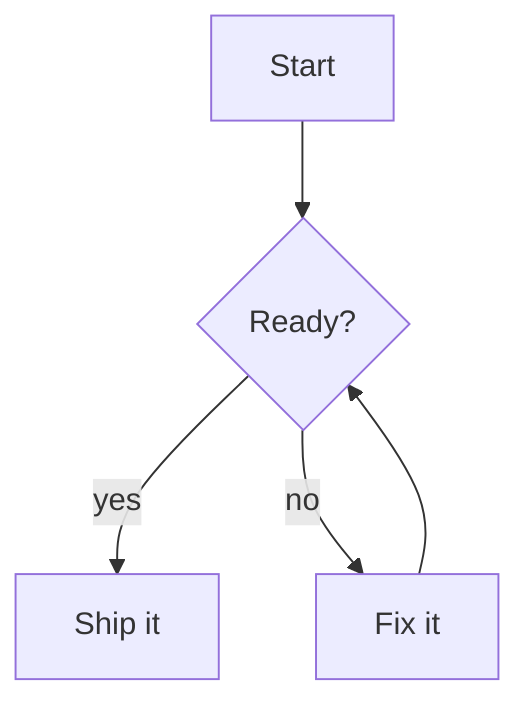

Node text in `{}` is a decision, `[]` a step. Group related nodes in `subgraph name ... end`.

## Sequence — actors exchanging messages

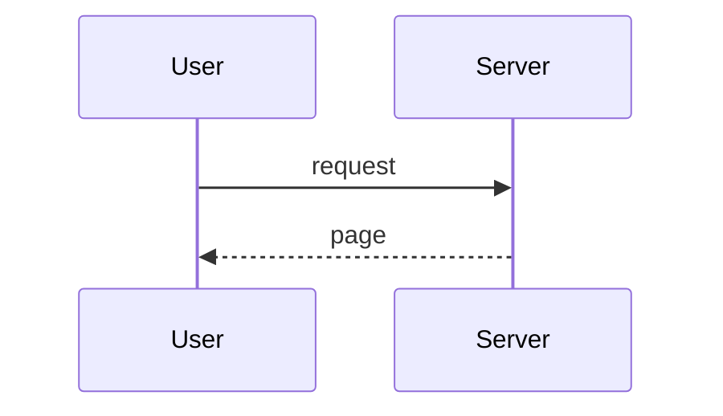

`->>` is a call, `-->>` a return. Name actors with `as` so the labels read well.

## Class — types and relations

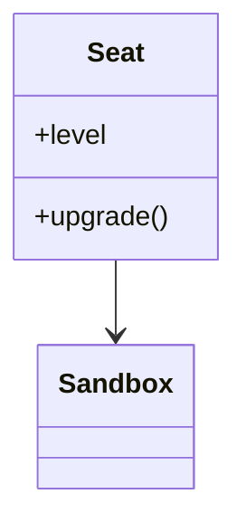

## State — states and transitions

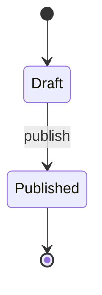

## ER — entities and relations

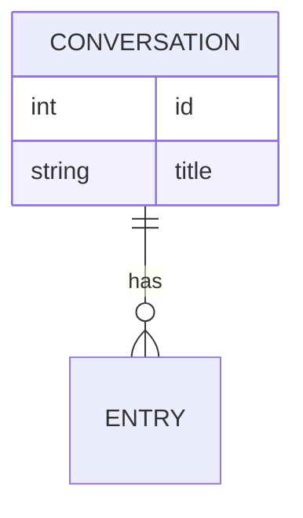

## Gantt — work over calendar time

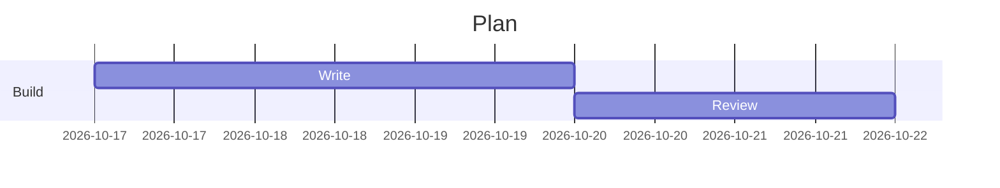

A task is `name :id, start, length`; chain with `after <id>`.

## Timeline — events in order

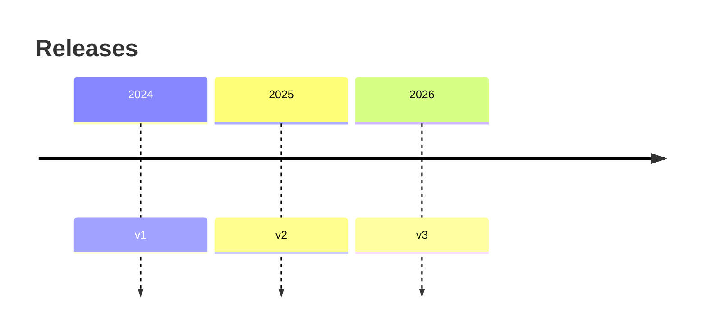

## Git graph — branches and merges

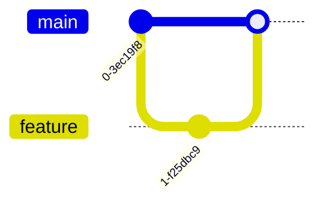

## Pie — parts of a whole

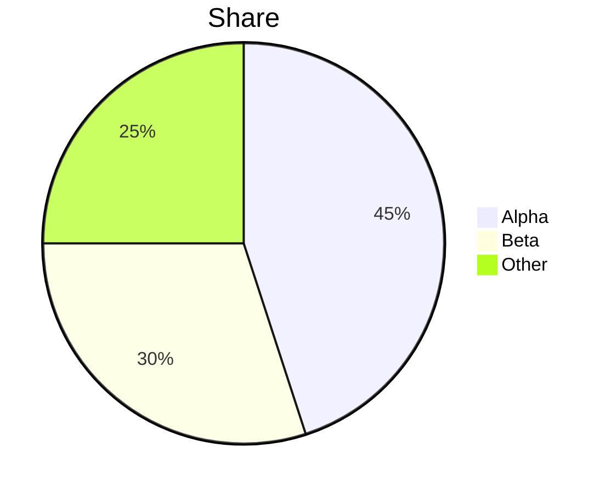

## Mindmap — ideas branching from a center

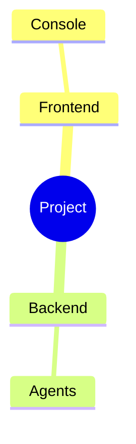

Indentation is the structure. `((x))` is a circle, `[x]` a rectangle.

## Journey — steps and how they feel

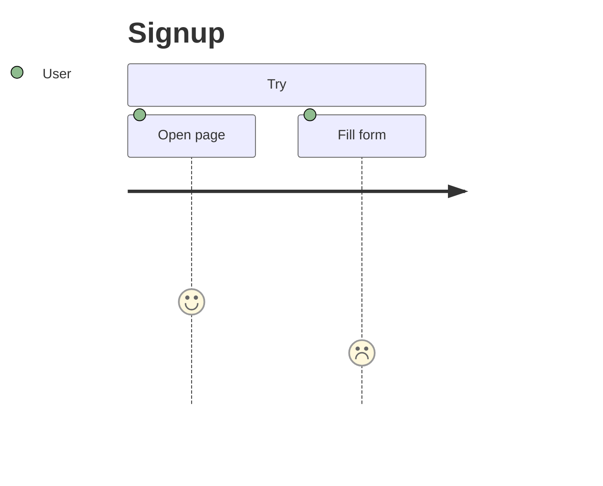

Each step scores 1-5 and names its actor.

## Quadrant — items on two axes

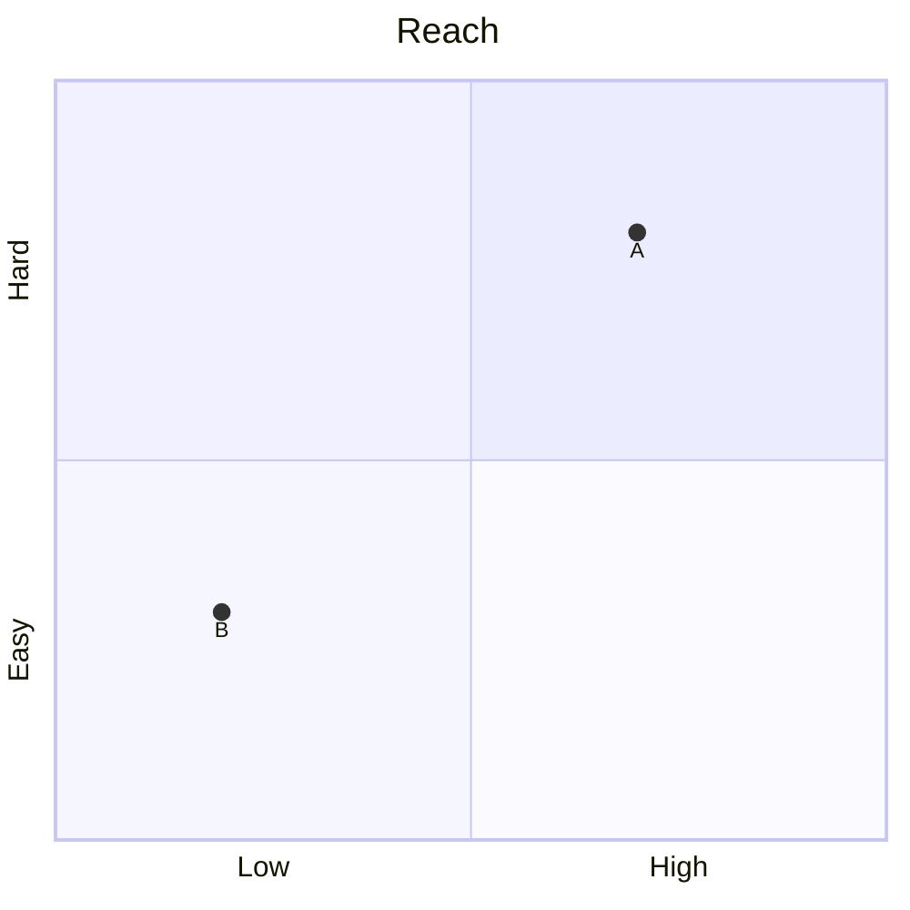

Points are `[x, y]` from 0 to 1.

## XY chart — numbers over categories

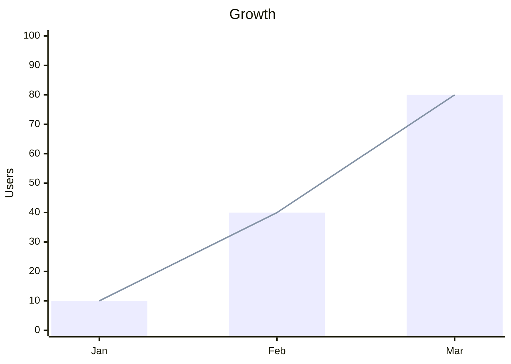

## Sankey — quantities flowing between nodes

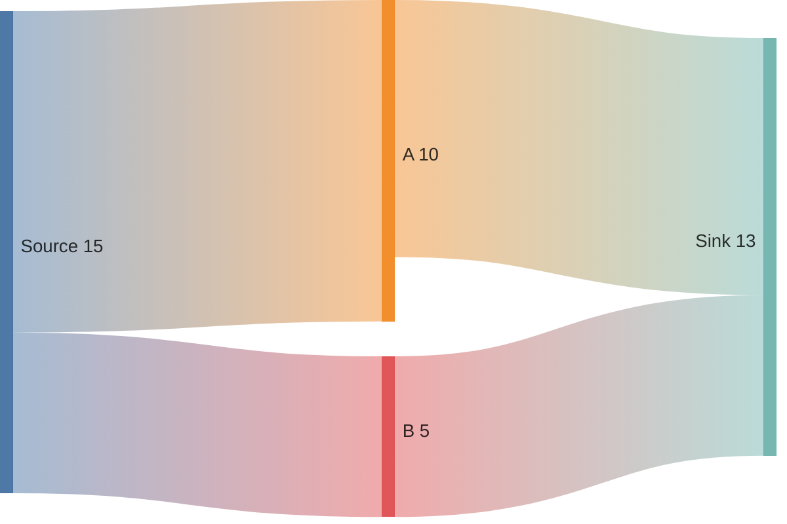

One `from,to,amount` per line; nodes come from the names used.

## Architecture — services in groups

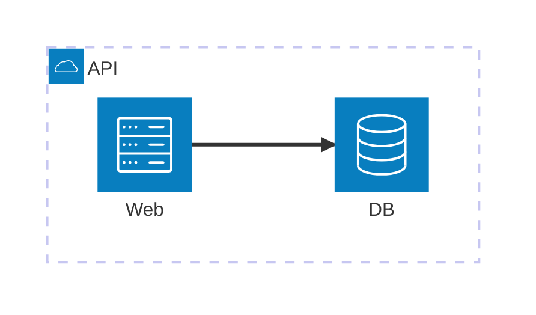

## C4 — a system and its actors

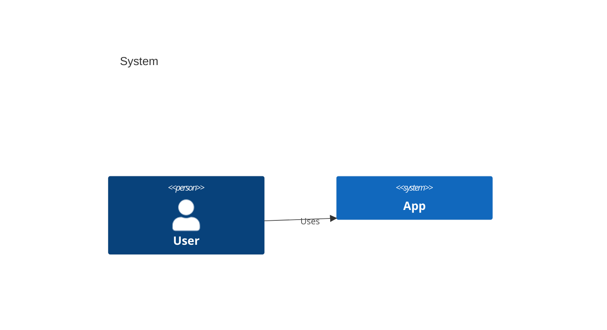

## Block — boxes in a grid

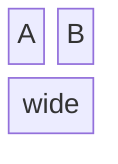

A label followed by `:n` spans n columns.

## Kanban — work cards in columns

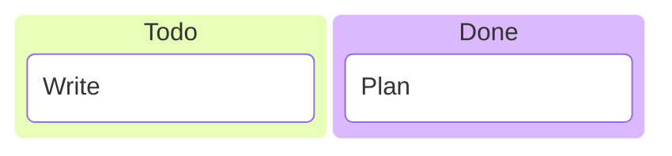
